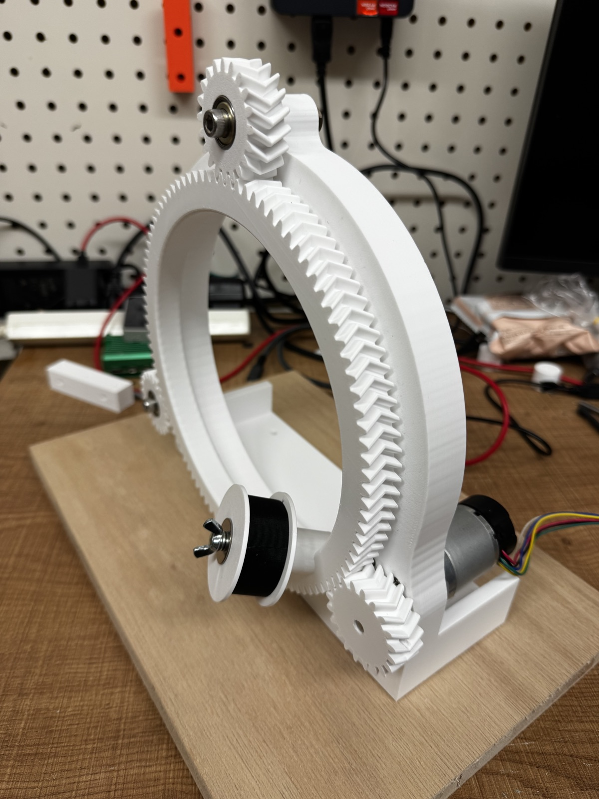
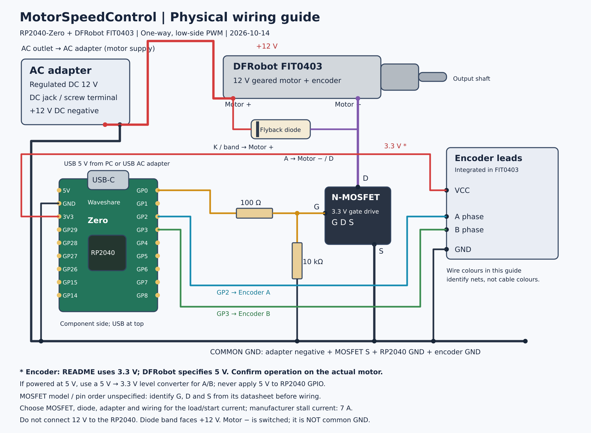

# MotorSpeedControl



This project was made for the [Spiral Cable Taping Machine](https://makerworld.com/ja/models/3301514-spiral-cable-taping-machine). See the MakerWorld page for details of the machine.

Firmware for the RP2040-Zero that holds a DC geared motor (DFRobot FIT0403) at a constant speed.

You type a target speed (for example `t 60` for 60 rpm) into the serial monitor. The firmware reads the motor's built-in encoder and keeps adjusting the PWM output so the speed stays on target, even when the load changes.

- The motor turns in one direction only. A single MOSFET switches it on and off with PWM; there is no H-bridge.
- Speed is held with a PI controller using encoder feedback.

## What you need

| Part | Notes |
|---|---|
| Waveshare RP2040-Zero | Microcontroller board |
| DFRobot FIT0403 | 12V geared motor (90:1, 122rpm at the output shaft with no load) with a built-in quadrature encoder |
| Logic-level N-ch MOSFET | Switches the motor on the low side (between the motor and GND). The RP2040 drives the gate at 3.3V, so choose a part whose on-resistance (Rds(on)) is specified at a gate voltage of 3.3V or lower. Pick a drain-source voltage of 30V or more and a current rating well above the motor's current |
| Flyback diode | A Schottky diode such as the 1N5822 (3A, 40V). It absorbs the voltage spike when the motor switches off |
| Resistors | 100Ω (gate series resistor) and 10kΩ (gate pull-down) |
| 12V DC power supply | Powers the motor, for example an AC adapter with a DC jack |
| USB-C cable | Connects the RP2040-Zero to your PC for uploading, serial communication and power |
| Breadboard and jumper wires | |

## Wiring



### RP2040-Zero connections

| RP2040-Zero pin | Connects to |
|---|---|
| GP0 | MOSFET gate through a 100Ω resistor. Also connect a 10kΩ resistor from the gate to GND |
| GP2 | Encoder phase A |
| GP3 | Encoder phase B |
| 3V3 | Encoder VCC |
| GND | Common GND (encoder GND, MOSFET source, 12V supply −) |
| GP16 | On-board WS2812 LED (built into the board, no wiring needed) |

### Motor power connections

| From | To |
|---|---|
| 12V supply + | Motor + |
| Motor − | MOSFET drain |
| MOSFET source | GND (shared with the RP2040 GND) |
| Flyback diode | Across the motor terminals: the band (cathode) to Motor +, the other end (anode) to Motor − |

### FIT0403 cable colours

These are the colours given by DFRobot. Check them against your own cable before connecting.

| Wire colour | Function |
|---|---|
| Red | Motor + |
| Black | Motor − |
| Green | Encoder GND |
| Blue | Encoder VCC |
| Yellow | Encoder phase A |
| White | Encoder phase B |

> [!WARNING]
> - **Never connect 12V to any RP2040-Zero pin**, including 5V and 3V3. The RP2040-Zero is powered from USB only.
> - **Connect the 12V supply − to the RP2040 GND.** Without a shared GND, the MOSFET will not switch.
> - **Check the MOSFET pinout in its datasheet.** Many TO-220 parts are G-D-S from left to right when viewed from the front, but not all.
> - **Mind the diode direction.** If it is reversed, it shorts the 12V supply when the MOSFET turns on.

The encoder is powered from 3.3V here, so phases A/B can connect straight to the RP2040 pins. This has been tested on real hardware. If you power the encoder from 5V instead, you need a level shifter on A/B, because the RP2040 pins only accept up to 3.3V.

## Getting started

This project uses [PlatformIO](https://platformio.org/). The easiest way is to install the PlatformIO IDE extension in VS Code. The first build downloads the RP2040 toolchain automatically, which takes a while.

1. Clone this repository and open the folder in VS Code (or a terminal).
2. Build:
   ```sh
   pio run
   ```
3. Upload. **The first time**, hold down the BOOT button on the RP2040-Zero while plugging in the USB cable, then release it. The board appears as a USB drive. After that, normal uploads work without the button.
   ```sh
   pio run -t upload
   ```
4. Open the serial monitor (115200bps):
   ```sh
   pio device monitor
   ```
5. Connect the 12V supply, type `t 60` and press Enter. The motor should spin up to 60 rpm.
6. Type `s` to stop.

## Serial commands

Type a command and press Enter.

| Command | Description |
|---|---|
| `t <rpm>` | Set the target speed in output shaft rpm (0–122). Example: `t 60` |
| `s` | Stop the motor |
| `kp <value>` | Set the proportional gain. Example: `kp 0.005` |
| `ki <value>` | Set the integral gain. Example: `ki 0.03` |
| `?` | Show help and the current gains |

Gains set with `kp` and `ki` are lost when the board resets. To keep values you like, change `DEFAULT_KP` and `DEFAULT_KI` in [include/config.h](include/config.h).

### Output and LED

The firmware prints a line 10 times per second:

```
target:60.0 rpm:59.8 duty:52.3
```

- `target`: target speed (rpm)
- `rpm`: measured speed (rpm)
- `duty`: PWM duty cycle (%), that is, how much of the time the motor is switched on

This `name:value` format can be graphed directly with a serial plotter, such as the Arduino IDE Serial Plotter or the Teleplot extension in VS Code.

The on-board LED shows the state:

| Colour | Meaning |
|---|---|
| Blue | Stopped |
| Yellow | Running, still approaching the target |
| Green | Within ±5% of the target |

## Troubleshooting

| Symptom | What to check |
|---|---|
| The upload fails or no port is found | Hold BOOT while plugging in USB, then upload again. Make sure the USB cable carries data (some cables are charge-only) |
| Nothing appears in the serial monitor | Check the speed is 115200bps. Wait a few seconds after uploading for the board to reconnect |
| The motor does not turn | Check that the 12V supply is on, that the 12V − is connected to the RP2040 GND, and the MOSFET pinout |
| The motor runs at full speed and does not slow down, or `rpm` is negative | The count direction is reversed. Set `ENC_REVERSE` in [include/config.h](include/config.h) to the opposite value (`true` ↔ `false`) |
| `rpm` stays at 0 while the motor turns | Check the encoder wiring: VCC to 3V3, GND to GND, phases A/B to GP2/GP3 |
| The speed oscillates | Lower `kp` and `ki` a little at a time |

## How it works

- **PWM**: 20kHz, which is above human hearing, so the motor does not whine. The duty cycle has 1000 steps.
- **Speed measurement**: the encoder produces two square waves (A and B). The firmware counts every rising and falling edge of both, which gives 4 counts per pulse (x4 decoding). One output shaft revolution is 16 pulses × 4 × 90 (gear ratio) = 5760 counts. Every 10ms, the change in count is converted to rpm and smoothed with a low-pass filter.
- **Control**: 100 times per second, the firmware sets the duty from three parts:
  - **Feedforward**: a starting guess from the target speed alone (target ÷ 122 rpm).
  - **P (proportional)**: a correction proportional to the current speed error.
  - **I (integral)**: a correction that builds up over time to remove any remaining error. *Anti-windup* stops it from building up while the output is already at 0% or 100%.

Pin assignments, PWM settings, gains and the encoder direction (`ENC_REVERSE`) are all in [include/config.h](include/config.h).

## File layout

```
include/config.h          Settings (pins, PWM, motor constants, gains)
src/main.cpp              Control loop, serial commands, telemetry
src/motor.cpp             PWM output
src/encoder.cpp           Encoder counting
src/speed_controller.cpp  Feedforward + PI speed control
docs/                     Wiring diagram
```

## License

[MIT License](LICENSE)
